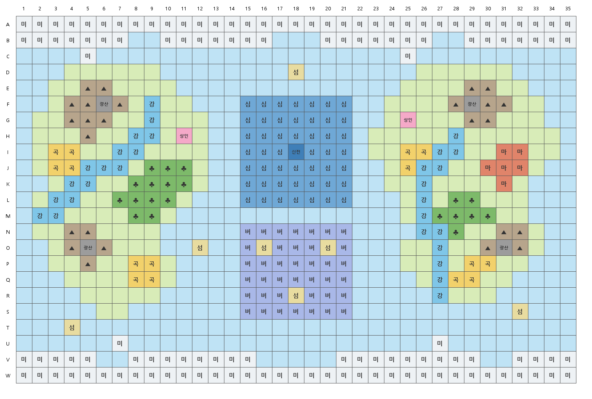

# 보드판

> [!TIP] 지금 쓰는 게임판
> 실사 지도 [게임판_인쇄.pdf](게임판_인쇄.pdf) (A4 4장, 570 × 380mm, 72 × 48칸). 원본은 `세계/격자 진하게` 그림 4장, 붙이는 순서와 방법은 [인쇄 목록](인쇄목록.md). 아래 내용은 첫 초안 기록이다.

> [!NOTE] 칸 크기 결정: 7.5mm (72×48칸)
> 군대는 주사위를 최대 6개 굴려(평균 21칸, 최대 36칸) 움직인다. 7.5mm면 최대 이동이 판 가로의 절반이라 한 번에 판을 건너지 못한다. 10mm는 너무 빠르고, 5mm는 재앙 범위(3칸, 2×2)가 거의 안 보인다. 실사 지도는 [실사 지도 프롬프트](실사지도_프롬프트.md)로 만든다. 아래 PDF는 15mm로 만든 첫 초안이라 칸 크기가 다르다.

- 인쇄용 (15mm 초안): [보드판.pdf](보드판.pdf). A4 가로 4장(①②③④) + 범례 1장.
- 35칸 × 23줄, 한 칸 15mm. 다 붙이면 525 × 345mm.
- 칸 이름 = 줄 알파벳(A~W) + 열 번호(1~35). 예: I18 = 바다의 신전.
- 시작 지점은 정해 두지 않음. 각자 원하는 곳에서 시작.
- 지형 배치는 초안. 친구들이랑 보고 고치면 됨.

## 배치 (초안)

| 지형 | 위치 |
|---|---|
| 미개발지 | 맨 위 A~B줄(북극), 맨 아래 V~W줄(남극), 그 근처 몇 칸 |
| 서쪽 대륙 | 2~12열. 산맥과 광산(F6, O5), 상인의 마을(H11), 곡창지대 2곳, 정글 |
| 동쪽 대륙 | 22~33열. 산맥과 광산(F29, O31), 상인의 마을(G25), 마계(I~K, 30~32열), 곡창지대 2곳, 정글 |
| 강 | 대륙마다 1줄. 산 근처에서 시작해 바다로 빠짐 |
| 심해 | 가운데 F~L줄, 15~21열. 가운데 I18이 바다의 신전 |
| 버뮤다 삼각지대 | 가운데 아래 N~S줄, 15~21열. 섬 3개(O16, O20, R18) |
| 섬 | D18, O12, S32, T4 |

## 만드는 법

1. [보드판.pdf](보드판.pdf)를 **실제 크기(100%)** 로 인쇄. "페이지에 맞춤"이면 칸 크기가 어긋남.
2. 각 장의 회색 "자르기" 부분을 검은 테두리를 따라 잘라냄.
3. ①②③④ 순서로 맞대고 뒷면에 테이프로 붙임.

## 지형 바꾸기

1. [지도.txt](지도.txt)를 고침. 한 글자 = 한 칸. 글자 뜻은 파일 맨 위에 있음.
2. 이 폴더에서 `python 보드판_만들기.py` 실행 (Pillow 필요: `pip install pillow`).
3. [보드판.pdf](보드판.pdf)와 미리보기가 새로 만들어짐.

Related: [실사 지도 프롬프트](실사지도_프롬프트.md) · [지형](../세계/지형.md) · [부품](부품.md) · [재앙 카드](../카드/재앙카드.md)
